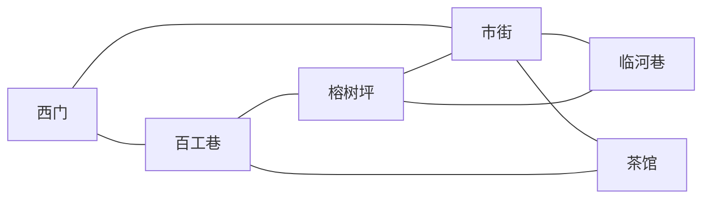

# 成都首片：相连街巷

## 当前修订：0.4.1 街巷回环

用户反馈「城市结构过于线性」。本轮将串行街路改成有分岔与回环的街区；六地点的具体规模、布局与节奏仍是实施候选，等待本轮试玩。

- 新增百工巷与榕树坪。西门可选市街或百工巷；两路都能走到临河巷，榕树坪也直通市街。
- 茶馆前门接市街，后门接百工巷，可以穿店通行。六地点有八条双向连接、三个独立回环；不以竹伞或修行进度锁路。
- 新巷道用错开的深院形成转角，榕树坪以中央树池分出三向路；原街区增加可见分路，茶馆北墙实际开后门，第二桌右移让出中轴。
- 免费城内转场仍由原 Session 执行行动、记录回执，再由成都界面自动收起旅行结果，落地即可继续走。普通查看仍显示结果，人物事件保留选择与收起；山城旅行仍显示一时辰消耗和结果。
- 原竹伞、重访、师徒与五剑保持。新内容版本 `0.4.1` 与 `chengdu_connected_loops` 存档目录隔离；不迁移四图或其他旧档。

新版本机试玩：[18861 成都街巷回环](http://127.0.0.1:18861/)，在 X1 桌面内浏览器打开。从听雨廊下山后，西门可选向北百工巷或向东市街。应用 `0.4.1-chengdu-loops`，用户目录 `shu-chengdu-loops-20261107`；18860 四图旧版继续保留，新版不读取其存档。



本轮使用固定 Godot `4.7.2.stable.official.ed1daf0bf` / GDScript / Compatibility。冻结构建 `.local/build/chengdu-loops-20261107/stage-c5ca9508c008`，270 项输入与源码、stage 均逐 SHA256 相等，未发生导入后漂移。源码仍为 `7c992c578b1fe4a1624c769812425b38080771d3` 加 dirty 改动；主副本为同 HEAD 的 clean main，远端 main 仍指向该提交。对上一冻结版逐字节核对，197 项旧包、共享运行代码与美术依赖保持。

| 验证层次 | 0.4.1 实际结果 |
| --- | --- |
| 内容与拓扑 | 255 项静态继承、引用、费用、入口及图结构检查通过。6 点、8 条双向连接、3 个独立回环；16 条有向边均无时间／资源费用、任务门禁或新事件。 |
| 冻结状态检查 | 六图真实数据445、原成都合同95、旧行走124、基础184，共 **848 项／0 失败**。逐方向走到真实出口，检查命名落点、替代路线、全部入口到互动的可达性、空间门禁、重复回执、伞与完整存读档；四组均退出0，日志无错误警告。 |
| 原生回环 | 1152×720、960×600 各 **154 项／8 图／0 失败**，均正常退出0。真实 Godot 鼠标事件走西门→百工巷→榕树坪→临河巷→市街→西门，再走百工巷→茶馆后门→市街；六图到访、转场立即ready、脚点、费用、走远后精确读档均过。 |
| 原玩法回归 | 同一最终stage于1152×720完成 **184 项／11 图／0 失败**，正常退出0：师父选择、人物相遇、菜单／确认输入遮挡、竹伞拒绝后接受／归还／重访、伞实物旗标、存读档、返山练剑与确认重开。 |
| 场景专项 | 六景1280×720真实渲染、几何／障碍检查通过；18组投影往返最大约0.0000611逻辑像素，未挂树骨点局部变换误差0，足影及伞flags保持。主代理已查看集成两尺寸的巷、坪、茶馆后门、归还与浏览器恢复画面。 |
| 字体 | 独立 Chengdu 字库按固定OFL源重新生成，903所需码点、0缺字；输入哈希与最终代码／内容一致，旧字体不变。 |
| Web构建与HTTP | 单线程导出退出0，导入／导出日志无错误警告。HTML收尾只固定画布和图标。七份Web文件约156.15MiB，完整HTTP读回与磁盘SHA256全部相等；PCK `a8afb3491057a4bd6d2ab5ae69f635f0b6a252ab8b2a544b8f0e7d8a25486cda`。 |
| 浏览器 | 独立Chrome profile实际鼠标回放24条输入／截图轨迹，完成回环、穿店与走远后加载；无pageerror、控制台错误／警告、失败请求或HTTP错误。在真实西门 `[1100,480]` 检查点保存并刷新，IndexedDB只读比对完整payload完全相等，SHA256 `c976b9cd18064e33e0253462ff95516c45876eff79a8971d22eb1cb6a3d08897`，保存时精力100、时辰1、town_visited=true及全部地图脚点恢复。没有注入游戏状态或伪造存档。 |

本轮收据在 `.local/qa/chengdu-loops/`：`state/receipt.json`、`native-1152`、`native-960`、`regression`、`browser/receipt.json`、`frozen-inputs.json`、`protected-inputs.json`、`http-artifacts.json` 与 `final-delivery.json`。三次原生图形QA进程串行使用各自独立 XDG_DATA_HOME。最初新增状态测试曾将JSON浮点数组与Session整数脚点直接比较，产生27项测试预期类型误判；修正测试的整数预期后445项通过，运行逻辑未因此改动，候选日志保留。

本轮 Windows／Steam Deck、实体键鼠、设备听感、低配长时性能与用户对新布局的认可仍未验证。没有提交、push、合并或公开发布。下方四图检查属于0.4.0留档，不能替代本轮结果。

复现构建仍使用 `tools/build_cultivation_engine.py`，入口不变，参数改为 `--title '蜀 · 成都街巷回环' --app-version 0.4.1-chengdu-loops --user-dir shu-chengdu-loops-20261107`。先导入返回stage，再跑 `tests/cultivation_engine_chengdu_loops_test.gd`；真实新路线为 `tests/cultivation_engine_chengdu_loops_render.gd -- --qa-size=1152x720` 或 `960x600`。原玩法回归仍用 `cultivation_engine_chengdu_render.gd`。导出后运行原HTML收尾工具。

当前试玩验收点：西门能否清楚看出两条路、绕巷是否顺畅、穿店能否自然衔接，以及能否凭不同路线回到熟悉街口。具体布局与密度继续按反馈修订。

## 0.4.0 首轮交付留档

以下保留四图候选的内容、构建与验证记录。`18860` 为旧试玩，新版入口与结果见上方。下列源码链接随工作区更新；0.4.0 的确切数据以本节记录的冻结 stage 为准。

客户端日期：2026-11-07，America/Los_Angeles。状态：内容与运行接入的实施候选；全城规模、街区密度、人物外观和具体节奏待用户试玩。构建、真实 UI、浏览器存读档及用户验收分别记录，不以本页的实施清单代替验证。

### 需求与本片边界

用户希望做一座庞大的成都城，并明确选择「很多相连的街区，能闲逛、进店、遇人和做事」。这确立相连街区的体验方向；此前八城区、数十处地点和虚构地图仍是规划提案，不能记成已建成或已确认的数量。

首片把 **西门 → 市街 → 临河巷** 连成一条可往返街路，并从市街进入茶馆。先让玩家实际感受跨街区、进店、匿名人物相遇与一件可拒绝的小事。四处场景不是完整成都；临河巷东侧明确标示「前路暂不通」，不放置不可用的假出口。地形为原创虚构构图，不声称复原历史成都。

### 内容包与现有规则

- 独立包：[`games/shu_chengdu/game.json`](../games/shu_chengdu/game.json)，ID `shu_chengdu`，内容版本 `0.4.0`，初始地点仍是 `tingyu_corridor`。
- 目录：[`games/chengdu_catalog.json`](../games/chengdu_catalog.json)，同时保留原 `stream_study` 作为同内核验证包。
- 源基线：`7c992c5`，在临时工作树 `codex/chengdu-connected-streets` 实施；主副本仍按 AGENTS 约定管理。开始时工作树干净，后续实际验证应记录当时 HEAD 与 dirty 状态。
- 宿主：沿用 `EngineSession`；不另建城市全局状态。地图位置、旗标、一次行动与真实回执仍由宿主校验和保存。
- 原师徒人物、`mentor_tip` / `mentor_practice_report` 事件、五剑行动、休息与规则保持；`rules.json`、`motions.json`、`voices.json` 逐字节继承 `shu_town_walk`。继承来源哈希见 [`source.json`](../games/shu_chengdu/source.json)。
- 独立内容版本、包 ID 与应用存档目录；不迁移或覆盖 `shu_town_walk`、P0、旧正式 Tea 等既有存档。
- 行走碰撞、可走地面、互动与命名入口在 [`walks.json`](../games/shu_chengdu/walks.json)；舞台构图在 [`chengdu-layout.json`](../assets/data/chengdu-layout.json)。表现层只展示，不决定费用或剧情旗标。

### 玩家可以观察的行为

| 行为 | 实施内容 | 时间／精力 |
| --- | --- | --- |
| 下山进成都 | 听雨廊 → 西门 `from_west`，沿用 `go_to_town` 行动 | 1 时辰／0 精力 |
| 跨街区闲逛 | 西门 ↔ 市街 ↔ 临河巷，走到出口后进入相邻场景的对应入口 | 免费 |
| 进店与出店 | 市街茶馆门 → 茶馆 `from_market`；茶馆出门 → 市街 `from_teahouse` | 免费 |
| 遇见人物 | 茶馆掌柜、窗边茶客；第一次与重访有不同系统叙述 | 免费 |
| 看街边物件 | 西门方向木牌、市街货架、河面与未开放货埠告示 | 免费 |
| 临河竹伞 | 可带走送到茶馆失物架，也可拒绝；归还一次，之后重访仍记得 | 免费，无数值奖励 |
| 返山继续养成 | 西门 → 听雨廊，原师徒、修行、五剑与加成状态连续 | 1 时辰／0 精力 |

茶馆人物暂为匿名职业，不加入正式人物名单。新城市事件只有 `choice` / `end`，通过 `chengdu_narration`（「街巷见闻」／系统叙述／空立绘）满足已安装事件合同，没有新增 `say`、人物对白或 TTS。原师徒配音与字幕绑定继续使用。市场货架只提供查看，不暗示本片已有货币交易或购买系统。

### 竹伞小事与存档不变量

河街木架挂牌，拾得物件可送茶馆失物架；这只是原创机制连接文字，不新增独立长篇支线原稿，也没有改动历史剧情归档。

1. 在 `river_umbrella` 走近查看，可选「顺路带竹伞回茶馆」或「先不管它，继续闲逛」。拒绝不扣资源、不关闭城市游玩，之后可以再来。
2. 选择带走通过 `take_river_umbrella` 原子提交：`chengdu_umbrella_taken = true`、`chengdu_umbrella_carrying = true`，一次键 `chengdu_umbrella_taken`。竹伞仅由旗标表达，不建立第二套背包。
3. 回到茶馆 `tea_lost_property`，有伞时可选归还，执行 `return_river_umbrella`：`chengdu_umbrella_carrying = false`、`chengdu_umbrella_returned = true`，一次键 `chengdu_umbrella_returned`。不收取费用，不给奖励。
4. 再看河街木架、失物架或重访掌柜，能读到归还后的记忆；归还选项不再出现。重复查看不重复归还，不重复领取。
5. 普通事件结束即回到当前场景自由游玩。玩家携伞时仍可离城返山，不强制把小事当作锁住养成的剧情支线。安全阶段存档应保留携带／归还旗标、街区位置与回执，普通对话进行中仍不保存。

### 地图与进入位置

四图逻辑尺寸均为 `1280 × 720`，地面 `[60,160,1160,490]`，角色半径 `12`，格距 `20`。西门、市街、临河巷的主路沿 `y=480`，北侧两组障碍为 `[250,200,250,130]` 与 `[780,200,260,130]`。茶馆两张桌的障碍为 `[300,250,190,120]` 与 `[620,230,180,120]`。

| 场景 | 命名入口 | 位置 |
| --- | --- | --- |
| `chengdu_gate` | `from_west` / `from_east` | `[180,480]` / `[1100,480]` |
| `chengdu_market` | `from_west` / `from_east` / `from_teahouse` | `[180,480]` / `[1100,480]` / `[640,370]` |
| `chengdu_teahouse` | `from_market` | `[640,570]` |
| `chengdu_river` | `from_west` / `from_east` | `[180,480]` / `[1100,480]`；东侧仅预留坐标，本片无货埠穿行 |

跨图行动使用 `actions.target_entry`，只改变目标地图已有位置字段，不另加持久状态字段。旧包未声明该字段时保留原 `spawn` 行为。实际脚点由宿主和导航验证；人物／物件不会另设隐藏的结算入口。

### 本轮验证与试玩点

本机试玩：[18860 成都入城](http://127.0.0.1:18860/)，应在 **X1 桌面内浏览器**打开。应用 `0.4.0-chengdu-streets`，独立用户目录 `shu-chengdu-streets-20261107`；菜单里保存、继续存档、语音开关与重新开始。源码入口为 [`cultivation_engine_chengdu.tscn`](../scenes/demos/cultivation_engine_chengdu.tscn)。

冻结构建为本工作树 `.local/build/chengdu-streets-20261107/stage-1eb66cc495be`，268 项编译／资源输入与源码逐 SHA256 绑定。源码 HEAD 为 `7c992c578b1fe4a1624c769812425b38080771d3` 加本轮 dirty 改动；主副本同 HEAD、clean main。固定 Godot `4.7.2.stable.official.ed1daf0bf`／GDScript／Compatibility，未更换引擎或渲染模式。额外的 HTML 收尾工具单独绑定，不改变 PCK／WASM。

| 验证层次 | 本轮实际结果 |
| --- | --- |
| 内容静态检查 | 189 项继承字节、师徒五剑保持、引用、命名入口、城内免费与链接检查通过。原规则／motions／voices 原字节保持；旧内容包未修改。 |
| 冻结输入与来源 | 268 项输入逐 SHA256 与源码一致；选定模型／材质等 53 项运行依赖 SHA256、字节数全部匹配。来源为 clean `first-journey` / `3676093`，选择性复用，不导入其整章或战斗。 |
| 导入与状态 | 冻结 stage 导入退出 0，无错误警告；基础184、动作179、物件152、师徒207、事件结束31、声音28、往返160、旧行走124、新成都93，共 **1,158 项／0 失败**，九组日志无脚本、资源错误警告。 |
| 原生 UI | 最终使用独立 XDG_DATA_HOME 的冷启动，1152×720、960×600 各 **185 项／11 图／0 失败**，共370项、22图；真实 Godot 鼠标／键盘分派，日志无错误警告。包含师父选择、四景绕障与进店、按来向落点、人物相遇、拒绝后再接竹伞、归还与重访、精确存读档、菜单／确认遮挡、返山完整练剑及确认重开。不是实体键鼠证据。 |
| 场景与人物 | 四景真实 Compatibility 画面已查看；可见实体与障碍检查通过，12组投影往返最大约0.0000611逻辑像素。三份已获认可的原日常模型／动画复用，城市新外观仍待试玩。取走后河边实物伞隐藏，归还后茶馆实物伞出现；未挂树构建和足影专项通过。 |
| 字体 | 独立 ShuChengduSerif，固定 OFL 源与既有fontTools 4.51.0，886所需码点、0缺字；原字库保持。 |
| Web | 单线程导出退出0，无脚本／资源错误警告。七份原始Web文件约156MiB；另提供本机构建元数据。PCK SHA256 `acd8eaad3e6aa9fca106426554a5c2f1466065c2ec2c89ec07e7e424a4bc5846`。完整HTTP读回与磁盘哈希相等；HTML收尾后另做最终读回。 |
| 浏览器 | 最终HTML在独立 Chrome profile，用实际 Playwright 鼠标／键盘回放89条原生输入／截图事件；完整路线、菜单确认、归还、返山练剑与重开通过，无pageerror、失败请求或控制台错误／警告。河街携伞时真实保存、刷新并继续，IndexedDB只读比对完整 `payload_json` 完全相等，SHA256 `cf5f64ecfa326d4654ac3ef1ec02d9e3b10436816c78df9ba0fbaf25e3f54a50`，恢复精力92／理解1、人物记忆、脚点与所有回执。重开后的画布位置已实际查看。未注入游戏状态或伪造存档。 |

首次原生集成发现角色未挂树时读取世界变换，已修为局部骨点计算，并补 detached 探针；首次候选日志保留。独立审查另外发现确认面板输入穿透、伞实物未随旗标变化，均已修复并加入真实 UI 断言。两窗口首次并行运行共用新应用 shader cache 时出现 GLES3 初始化错误；改用每进程独立 XDG_DATA_HOME 后冷启动完整通过，推断与共享缓存初始化竞争有关，没有据此修改引擎。首次浏览器完整路线仅有 favicon 404；回山重开后还发现浏览器焦点引起画布偏移，因此增加仅调整导出HTML的 `finalize_chengdu_web.py`，固定画布在视口内并复用导出图标，最终浏览器及HTTP结果另存。

实际收据位于本工作树 `.local/qa/chengdu-integration/`：`final-state/receipt.json`、`cold-1152`、`single-960`、`browser`、`browser-fixed`、`http-artifacts-final.json`、`web-shell.json`；场景专项为 `.local/qa/chengdu-scene/`。两个窗口首次并行冷启动的 `cold-960` 在检查完成后进程被SIGTERM（143），保留原记录，960最终证据采用单独重跑；不把中断退出当作正常退出。主代理已查看两尺寸茶馆／事件、河街、归还和浏览器恢复／重开截图。Windows／Steam Deck、实体输入、设备听感、低配与长时性能、用户新城市观感均未验证。本轮未提交、push、合并或公开发布。

复现：

```bash
cd /home/x1-lite/.codex/worktrees/chengdu-connected-streets/shu
python3 tools/build_cultivation_engine.py \
  --output /absolute/existing/build-directory \
  --entry scenes/demos/cultivation_engine_chengdu.tscn \
  --title '蜀 · 成都入城' --app-version 0.4.0-chengdu-streets \
  --user-dir shu-chengdu-streets-20261107
```

用固定引擎对返回stage导入，运行 `tests/cultivation_engine_chengdu_test.gd`；真实画面测试为 `tests/cultivation_engine_chengdu_render.gd -- --qa-size=1152x720` 或 `960x600`。每个图形QA进程使用独立 `XDG_DATA_HOME`，避免互写应用shader cache。对同stage的 `Web` 预设导出到其绝对 `web/index.html` 后，运行 `python3 tools/finalize_chengdu_web.py /absolute/stage/web`，再启动本机HTTP服务。HTML工具是仅用Python标准库的构建后步骤，保留PCK／WASM字节。

建议本轮试玩顺序：从听雨廊进西门，读木牌；走到市街，进茶馆遇见掌柜／茶客；到临河巷先拒绝竹伞，再选择带走；回茶馆归还并重访；安全阶段保存重进，确认原位置与记忆；返山完成听教、任选五剑与复命；重置后确认城市旗标和位置回到初始状态。

下一验收点是四场景连接、街路尺度、转场落点、进店感受和遇人密度。用户反馈后再选下一条真正可玩的街路；扩展八城区、正式人物、长篇事件、交易、战斗、全城日程与发布仍须按实际后续范围推进。
