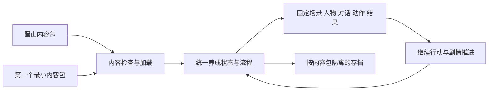

# 内容驱动的养成模式引擎 v0.1：范围与首轮验收

客户端日期：2026-10-23。

方向来源：用户「我倾向于做一个养成模式引擎，之后我们只需要加人物，场景和剧情就可以做出游戏」。该条记录用户的产品偏好；以下模块、目录与分期是 Codex 的实施提案，尚未成为已实现接口。现有正式试玩见[五套练剑闭环](FORMAL_FIVE_SWORD_CYCLE_SLICE.md)，历史工具包设计见[CULTIVATION_MODE](CULTIVATION_MODE.md)。

实施追记（同日）：用户随后明确授权先做 E1 双包、完整基础循环与存读档。该切片已实现并完成本机窗口／Web刷新检查，实际接口和证据以[当前切片](CULTIVATION_ENGINE_V0_SLICE.md)及[运行库](../addons/cultivation_mode/README.md)为准。下面保留实施前提案；其中拟定类名不取代现有 API，E2／E3仍为后续范围，用户试玩认可尚待确认。

E2首片追记：用户进一步授权先通过内容包接入五套剑法，完成动作、唯一结算、返回与存档续玩。[v0.2切片](CULTIVATION_ENGINE_V02_SWORD_SLICE.md)记录当前实现和证据；天气／生趣、完整Tea与编辑器没有据此同时实施。下面的整阶段提案保持为历史规划，不用于否定已实现的有限能力。

## 目标：一套运行层，多个内容包

继续使用本项目锁定的 Godot 4.7.2 stable、GDScript 与 Compatibility。Godot 承担底层运行；本项目增加固定场景养成的规则、流程、表现和内容加载能力。

在已支持的玩法内，制作下一款游戏主要添加人物素材、场景配置、剧情和规则数据。属性名称、行动消耗、日程长度与成长目标也属于内容，不能继续写死为蜀山专用。新角色动作、场景原画和剧情仍需制作与审阅；内容包声明可用素材和表现能力，引擎负责组织与播放。



## 当前可以复用的基础

2026-10-23 只读检查当前 dirty 工作区所得；新增或修改中的源码均保持。

| 基础 | 现有实现 | 需要解开的绑定 |
| --- | --- | --- |
| 行动与结算 | [DemoState](../scripts/demo_state.gd)和[rules.json](../assets/data/rules.json)支持训练、休息、师傅、练剑与 Tea | 行动方法、状态字段、规则入口和 Tea 特殊分支仍由代码决定 |
| 人物与对白 | [characters.json](../assets/data/characters.json)、[dialogue.json](../assets/data/dialogue.json)提供姓名和正文 | [main.gd](../scripts/main.gd)固定载入人物画面、对话主题及场景入口 |
| 场景往返 | [CultivationSceneRouter](../scripts/cultivation_scene_router.gd)共用一份宿主状态 | 路由只登记听雨廊和后山，尚无通用场景注册与内容包入口 |
| 多动作选择 | [剑谱 catalog](../scripts/sword_manual_catalog.gd)、[后山界面](../scripts/back_mountain_view.gd)已按数据生成选项 | 资源路径、动作能力与宿主接入仍有当前案例限制 |
| 分段剧情与物品 | Tea 已有调查、回忆、一次性回执和整条结束后返回 | 阶段推进与 UI 包含专用代码，不能把现有 JSON 直接称为通用剧情引擎 |
| 存档与换游戏 | 当前正式流程以内存状态运行 | 尚未实现游戏存读档和通用内容包切换 |

这些能力适合做提取来源和回归基线；现有多份 JSON 还不足以证明整款游戏能靠换数据运行。

## 引擎和内容各自负责什么

| 引擎负责的共用能力 | 内容包提供的具体内容 |
| --- | --- |
| 时间推进、属性上下限、资格检查、一次结算及真实结果 | 时间单位、属性定义、初始值、行动成本／收益和目标 |
| 行动选择、繁忙状态、表现完成、结果与返回 | 行动清单、可用条件、动画／事件引用和返回地点 |
| 对白、选择、条件、阶段旗标、物品调查和终点判定 | 人物台词、选择分支、前置条件、物件和结局路径 |
| 固定场景、人物槽位、热点和已有表现组件 | 背景层、人物资源、位置／锚点、遮挡、天气区域及可用动作 |
| 状态快照、存读档和内容版本检查 | 游戏 ID、内容版本、起始地点和声明的能力版本 |
| 缺失资源与引用诊断、当前内容预览、打包入口 | 素材文件、来源／许可、索引和导出清单 |

内容定义“发生什么”，通用流程负责“如何可靠地发生”。先用有限、已登记的条件和效果表达现有玩法；新增玩法遇到表达不了的具体案例，再扩展能力。剧情数据不执行任意脚本。

## 内容包草图

以下仅表达职责和引用关系；字段与文件拆分在首轮实现时根据实际消费者确定，不同时维护 JSON 与 Resource 两份规则真相。

```text
addons/cultivation_mode/       # 拟议的唯一共用运行代码
games/<game_id>/
  game.json                   # ID、版本、起始场景、目录和所需能力
  characters.json             # 人物与可用立绘／表情／动作
  rules.json                  # 属性、时间、行动效果和成长目标
  scenes.json                 # 场景、槽位、热点和环境配置引用
  activities.json             # 行动入口、规则与事件／表现引用
  events/                     # 对白、选择与分段剧情
  assets/                     # 画面、动作、声音及来源索引
```

一局运行只有一个权威状态；规则数据只有一个结算入口。提取期间通过适配器保留现有 DemoState 行为，禁止新旧状态同时结算。人物与场景适配器只表达表现，不另扣精力或推进剧情。原始主／支线归档位置继续遵守仓库规则，内容包保存获准用于运行的版本与来源。

稳定人物、场景、行动与剧情 ID 不随显示名变化；蜀山原剑谱计数键与 Tea 信息顺序保持。内容先检查完整引用与所需能力，再激活或开始扣费；失败给出文件和缺失 ID，保留可恢复状态。

存档至少携带游戏 ID、内容／存档版本、权威状态、剧情阶段、当前地点、一次性回执和会话信息。同一包才能恢复；不兼容版本需明确迁移或拒绝，不能静默当新游戏。首轮选择安全的可存节点，动画中禁存或恢复策略写明；读档不重复发奖、不重扣费。文件写入失败仍保留此前有效存档。Web 刷新后的恢复必须实际验证，浏览器清理站点数据后的恢复不作保证。

## 分期：先证明内容能换，再扩大制作工具

| 阶段 | 可观察的交付 | 验收门槛 |
| --- | --- | --- |
| E1 可运行内核 v0.1 | 共用加载器、规则／状态与简单场景 UI；一个蜀山基础养成包和一个更换人物、属性、行动、剧情的最小验证包 | 同一份运行代码切换两包；各包能行动→结算→人物选择→继续行动，能新开局、存档与刷新后读档 |
| E2 接回现有完整体验 | 逐项接回正式五套练剑、天气／生趣、Tea 对象与分段剧情 | 现有结算、信息顺序、动作收势、阶段停留与整条返回行为保持；再补充第二个真实内容的用户试玩 |
| E3 内容制作工具 | 校验、预览、素材／字库与导出命令；在反复编辑的配置上做小型可视化面板 | 新人物／场景／剧情的常规制作只改内容包；报错可定位，原故事与包保持可玩 |

E1 的第二个包是明确标注的验证样例，复用合法现有素材或使用文字人物；它不作为第二款正式游戏的内容验收。E1 覆盖基础养成闭环；按原分期，五套动作迁移属于E2，现已实现为[v0.2第一片](CULTIVATION_ENGINE_V02_SWORD_SLICE.md)，完整Tea与可视化编辑器仍待后续切片。现有8805正式流程作为抽取前基线保留供对照。

## E1 的验收清单

1. **换内容不用改运行代码**：第二包使用不同的游戏／人物／场景／属性／行动 ID；运行层不得判断“江砚秋”“听雨廊”或包名来选择逻辑，记录两包消费的同一运行代码哈希。页面能看出确实换了内容。
2. **行动算得准**：消耗、成长、上限与时间都来自所选包；精力不足和坏资源不会部分扣费；重复输入不会二次结算；显示结果来自真实回执。
3. **剧情能衔接**：对白与选择来自数据，条件控制后续内容；普通互动结束后能继续行动。重置使旧回调失效。支线阶段／整条返回门禁在 E2 按现有真实 Tea 用例迁移。
4. **存档能继续**：两包存档隔离；重开／刷新实际恢复时间、数值、剧情与一次性结果；存档损坏、写入失败和不兼容内容明确报错，不覆盖有效存档。
5. **画面可试玩**：实际点击行动、人物与继续按钮，检查结果、返回、排版和重置；先验 Web，本机原生、Windows 运行、声音与长期性能分别报告。

这是有限玩法集合上的内容复用目标。新战斗、自由行走、全新小游戏、任意角色自动绑定和自动生成剧情不属于 v0.1；出现具体需求时再按独立切片扩展。

## 方案整理轮记录（实施前）

本轮完成运行代码现状盘点、引擎方向与 E1 验收提案；运行层、内容包和存档尚未实现。后续首个实施入口建议为 E1 的两包纵切，山门新剧情暂不作为同一轮工程范围。该顺序是 Codex 的安排建议，用户的方向偏好不等于整个 E1–E3 方案已验收，也不包含 Git 或公开发布。
