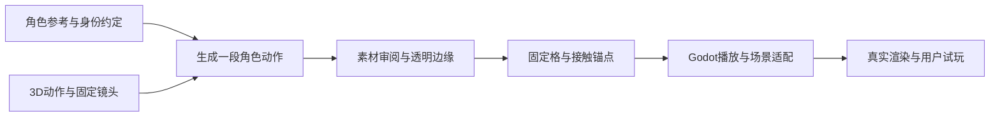

# 图像动作制作方法 v1.1

初版客户端日期：2026-10-11；更新：2026-10-12。原后山转身挥剑v4获得「已经很好了」反馈，新剑／拳两招后山预览获得「不错」反馈；本文固化已验证方法与扩展门槛。方法与工具成熟度分开：现有选定包在已记录的本地工具链中可重建，棍法生成、通用批处理、正式养成替换及多角色量产尚未验证。逐平台与用户反馈范围见各切片记录。

执行入口：[game-image-motion-build](../.agents/skills/game-image-motion-build/SKILL.md)；开始新招式时复制[单招式任务卡](../.agents/skills/game-image-motion-build/references/shot-brief-template.md)。当前案例、所有阶段检查和局限见[后山单式记录](SWORD_IMAGE_BACK_MOUNTAIN_SLICE.md)。

## 分工与适用范围

**动作参考 → 角色图像时序生成 → 透明帧 → 固定锚点播放 → 场景融合 → 实际试玩。**

- 3D／真人动作提供可审阅的身体结构、转向、重心与节奏参考。原画确定角色身份、服饰与画风。
- 生成阶段把参考动作转成角色画面。结果需要与动作参考比较；参考精确不保证输出骨点、手、武器或脚步逐点精确。
- 离线处理解决 alpha、固定格、脚底锚点和来源记录。Godot运行时显示已制成的素材，读场景时辰天气并应用呈现；不实时生成新招式。
- 宿主／DemoState拥有行动、资源、时辰与Tea等玩法状态。动作播放器不结算奖励。正式接入时沿用宿主一次结算与交互占用规则，不根据素材帧数重新决定消耗。

这条路适合固定镜头、少量人物、预制剑法／棍法与叙事演出。姿态、镜头、服饰或器械改变通常需要新的素材或验证；已经画好的2D帧没有任意观察角度或实时物理碰撞。当前后山小样是独立研究入口，不是已接入正式宿主的动作系统。

## 先写任务卡，再处理一段完整招式

一段素材对应一个稳定shot_id及版本。卡里写明目标场景、角色、器械、单双手握持、身体朝向、起势—发力—收势、播放方式、全动作包围盒、脚点、尺寸与证据。没有证据的seed、模型版本、许可或费用写未知。不能把目前61帧／25fps／384×576写成所有招式的标准。

动作差异从动作参考开始：步型、重心、转向、节奏、剑路和武器握持共同区别招式。换颜色、镜像或加快同一段素材不能替代新的动作设计；不对持剑手和武器做未经审阅的镜像。

| 阶段 | 输入与保留物 | 本阶段产物 | 扩到下一阶段前要看什么 |
| --- | --- | --- | --- |
| 角色与动作准备 | 原画、身份要点、带来源的3D／真人动作 | 单招式任务卡、参考视频及哈希 | 先看灰模身体协调、脚步、握持和完整起收势 |
| 输入校准 | 固定相机、角色比例、全动作范围 | 人物与武器都留足空间的输入 | 全部帧中剑尖／棍端不出画；背景与阴影不污染人物边缘 |
| 生成 | 已授权参考和动作输入，保存精确参数 | 原始视频及生成记录 | 正常速与半速看身份、身体、手剑／双手棍关系；错肢或错武器在这里退回 |
| 透明边缘 | 不可变原视频、解码RGB、模型版本 | alpha候选、局部修正配置和逐帧审阅表 | 换浅／深底并放入实际画景，检查白边、灰块、残影与误擦细部 |
| 打包与锚点 | 已选透明帧、原生时间基准 | atlas、帧表、接触锚点、来源哈希 | 固定画幅／比例，源帧顺序与时序明确，落脚自然，跳跃真实升离地面 |
| 场景呈现 | 已选包、场景自身色调与落点 | 接地影、world调色、可选轻纸感及A/B | 先边缘与接地，再色调与墨线，再微弱材质；保护脸、手与剑 |
| 交付与复用 | 冻结版本与可重建收据 | 原生／Web证据、用户反馈及可回退版本 | 分开记自动检查、实看、设备与用户认可；只把通过的版本作为下一段基线 |

输入时应追求简单背景、没有烘焙光晕或环境投影，但不假设生成服务会完全遵守。全动作留边包括头发、衣摆与武器最大伸展，不能只用站姿取景。零付费探索优先一段完整动作；原生帧率由素材决定，不先用插帧或交叉淡化掩盖动作错误。

## 透明边缘是独立的制作阶段

本轮灰块来自源视频的背景光晕被anime模型保留为实心人物。它与衣袍同样有高alpha，整体提高阈值会误擦人物；整幅general模型又会丢掉细剑。因此可复用的是判断和保护方法，而不是当前坐标或蓝色阈值：

1. 对齐源RGB、原alpha、修正alpha和真实画景，确认脏块确实属于背景。
2. 保留适合人物／细武器的基础alpha；另一模型提供局部候选，不直接全图替换。
3. 只在审阅过的时段、区域内更改，保护闭合衣袍、细发、发带、剑身和握持手。具体连通规则、颜色与轮廓按该段素材重做。
4. 保持RGB、帧次序、时序与锚点；alpha修改外区域逐字节一致。需要改RGB或重新生成时单列修订，不混入“只清边缘”的版本。
5. 看所有被处理帧的连续局部表，再看正常速／半速、浅深底、真实场景与Static。单帧好看不能证明时序边缘稳定。

v4只降低alpha；基础alpha已经丢掉的前景无法用这个操作找回。新招式若有剑／手缺失、出画或明显原片模糊，优先修输入／重新制作，不让shader或遮罩承担姿态修复。棍法必须单独保护两手、握点与棍端。

## 锚点稳定不能抹掉真实身体运动

同一段各帧使用同一个画幅与整体缩放；避免每帧紧裁切并按包围盒自动缩放，造成忽大忽小。alpha或颜色A/B切换保留同一时刻、同一帧、锚点和大小。

v4站定转身使用底部支撑区域取脚点，再做中值与高斯平移平滑；最大平移步进约3.06舞台像素是本样本的观测值。其底部连通部件、30%区域、8行支撑、sigma与半径均不是通用人体算法。新剑／拳使用固定首帧源锚点×cell_scale与统一演员尺度，保留源片身体／脚部位移，参数经后山代表帧查看；固定锚点本身不证明所有脚步无滑动。任务卡写明固定或逐帧、坐标基准、尺度转换及真实位移保留策略。

跃起、腾空、跨步或下蹲应根据源动作写明对应区间，分别确定舞台基点、真实身体位移与落地，不能把每帧最低像素都固定在地面。否则跳跃会被拉回地上、下蹲会被错误抬高。读取诊断字段前核对区域定义：现有`figure_bbox`实际来自局部脚部区域，不能据名称当作全人物包围盒。

单次动作完成后保留末帧。只有有完整起收势、首尾位置／速度／朝向／武器关系经实看连续的素材，才可声明为循环。两段动作拼接也应审阅接点，不能默认交叉淡化两个人影。

## 按职责复用与缓存

| 可共享部分 | 每段或每场景仍要决定的内容 |
| --- | --- |
| 角色参考、发型服饰识别点与来源记录 | 背面／侧面是否充分，生成结果是否保持身份；换装另有素材验证 |
| 带来源的3D动作、固定骨架和取景方法 | 新招式真正的动作差异、器械握持与起收势；一个动作不能自动适配任意角色比例 |
| 解码、模型调用、媒体探测、哈希和图集数学 | 该段帧率／尺寸、处理版本、细部保护和可接受边缘 |
| 帧表与固定格播放器、可选包路径和研究入口配置 | 每招站位／尺度、固定或逐帧锚点、片段接点与动作事件；选包可复用不等于握持或跨场景已验证 |
| 世界调色、接地和轻纸感的处理方法 | 场景色调、脚点／阴影、人物尺寸、材质强度与遮挡；后山参数不能直接成为茶亭默认 |
| QA流程与来源收据 | 每一新段、目标场景、真实设备和用户验收证据 |

原动作、原画和源视频不可变；修订创建新版本，只重新做受影响阶段。调纸感不重新生成动作，改局部alpha不重新取脚点，改后山调色不重做原视频。缓存应能区分源文件、模型及其预处理、工具版本与处理规格；alpha修正另绑定自己的区域配置。相同输入重用中间结果，不重发已成功或结果不明的外部任务。现有修整器只检查部分缓存来源合同，通用化时需把这些依赖显式化，不能声称全流程已有完整缓存键。

研究资产放在游戏仓库内时，同时检查普通游戏与独立预览的导出资源边界。[Godot资源选项](https://docs.godotengine.org/en/stable/tutorials/export/exporting_projects.html#resource-options)中的`all_resources`会导出未被主场景引用的资源。新剑／拳在正式两预设排除研究目录、场景和字体，而独立构建仍选自己的包；实际检查导出包的源资源、导入产物及其余资源保留情况，不能只看入口不引用或配置文字。

任务、素材与场景分工有助于批次并行：各招式独立输入、输出和责任人，单一整合者维护角色一致性、包引用与最终验证；不要让两个任务同时改同一个alpha包、字体或场景profile。按当前机器资源与仓库AGENTS安排重任务；制作skill不替代这些限制。

## 工具现状：有用的实现与尚待通用化部分

| 实际入口 | 已有能力 | 当前绑定／下一用例需做的改动 |
| --- | --- | --- |
| [prepare_pilot.py](../tools/sword_image_driven/prepare_pilot.py) | 离线参考图哈希、动作guide抽样／编码、完整解码及收据 | 固定原画SHA、384方格、CMU样本0–144和60／15fps、QA位置；第二动作须参数化 |
| [package_generated_clip.py](../tools/sword_image_driven/package_generated_clip.py) | 解码、已有ONNX分割、alpha、固定atlas、脚点与来源／版本／哈希记录 | 768×1152、61帧、25fps、2.44秒、图集格子和站定脚点算法写死；不是任意视频打包器 |
| [refine_clip_matte.py](../tools/sword_image_driven/refine_clip_matte.py) | 已审阅区域插值、保护前景、保留RGB、新包与原包并存、复用预测 | 固定原包路径／规格、模型MD5、帧段／轮廓、蓝色发带策略；别把当前配置复制到新人物 |
| [clip_actor.gd](../scripts/sword_image_driven/clip_actor.gd) | 可选manifest、帧表／fps／时长采样、暂停／重播／单次末帧；旧锚点平滑或显式固定源锚点 | 新剑／拳用固定首帧锚点保留源片位移；未实现通用腾空／移动策略，不能自动校准所有动作 |
| [back_mountain_pilot.gd](../scripts/sword_image_driven/back_mountain_pilot.gd)与[材质](../assets/shaders/sword_image_scene_blend.gdshader) | 可选包／标题／字体／固定位置尺度、可选清理alpha；色彩／纸感A/B、后山环境、Static／Resume | 仍继承研究standalone；新两招无清理包则隐藏该切换，参数按场景校准，不是正式宿主集成 |
| [build_pilot.py](../tools/sword_image_driven/build_pilot.py) | 白名单独立staging、输入和Web哈希、Godot导入／导出日志 | 依赖与入口固定后山，不是批处理服务或正式发布工具 |
| [prepare_input.py](../tools/hero_martial/prepare_input.py)与[package_clip.py](../tools/hero_martial/package_clip.py) | 单招输入编码与保护；按实际媒体测量、统一480方格、alpha／atlas和来源收据 | 仅本轮三个固定shot_id；已处理剑50／拳53帧，棍法无源片；旧局部清理规则不复用 |
| [build_review.py](../tools/hero_martial/build_review.py) | 新剑／拳各自后山白名单staging、冻结哈希与导出；排除source.mp4 | 仅两个研究入口；不包含棍法或正式玩法，也不是批量生成服务 |

2026-10-11的方法整理轮只保存文档、skill和任务卡，未改这些工具或创建runtime/addon；后续Git归档将现有单式与研究源码一同保存，归档检查独立记录。通用化保留现有小样作为回归：先增加最小配置入口，再迁移第二段，不复制整份controller或为了目录整齐重构整个工程。

## 使用环境与可重建边界

运行已选包需要锁定的 Godot 4.7.2 与仓库内 atlas／字体／场景依赖，不需要 ONNX 模型或在线生成服务。原单式的离线处理环境记录在[来源收据](../assets/art/sword_image_driven_v1/source.json)：Python 3.12.7、NumPy 2.4.6、Pillow 12.3.0、SciPy 1.18.0、ONNX Runtime 1.27.0、FFmpeg／FFprobe 8.0.1；这是实际使用的版本记录，不是安装锁文件。

新招式标题／控件可能超出原字体子集。核验随包字体cmap及导出依赖；原生Mac的系统字体回退不证明Web字形存在。新剑／拳新增独立OFL子集补齐标题，保留旧字体和默认选择；具体字数、源字体和SHA仍是案例数据。

重新制作 alpha 另需上述依赖和匹配 SHA 的 anime／general 模型文件，模型不随游戏包分发。本轮没有提供自动环境安装、完整依赖锁或从零环境重建验证；“可重建”限定于记录的现有工具链，不表示 fresh checkout 能立即运行所有离线处理命令。重新生成角色动作还依赖外部生成记录，其中未知项仍为未知。

CMU／江砚秋三维对照另有已安装 Blender 4.5.9 LTS 工具链；三个 `study.glb.import` 为源导入设置，需随 Git 保留 60fps 与关闭有损优化／压缩。忽略的 `.godot` 缓存和运行图集的普通 `.import` 文件不因此全部入库。

## 怎样扩到多招式

以下为扩大条件。2026-10-12已完成新剑／拳透明草稿、后山研究入口与最小参数化，用户反馈「不错」；棍法两次生成FAILED，三招全集、Windows及完整器械细节验收未完成，详见[本轮证据](HERO_MARTIAL_THREE_SLICE.md)。可用的招式独立交付；失败招式保留输入／结果，不伪造包或自动扩大重试次数。

| 阶段 | 产物 | 扩大条件 |
| --- | --- | --- |
| 已完成的基线 | 当前转身挥剑v4及用户认可、可重建单式处理与本方法 | 保留源片裁切、末段模糊与收势不足，不冒称发行级完整招式 |
| 两个真实复用用例 | 一段身体／剑路明显不同的剑法；一段双手棍法，目标溪边茶亭 | 身份一致、长武器留边、双手握持、腾空／蹲身如涉及则真实；分别独立试玩 |
| 最小通用化 | 参数化媒体合同／shot_id／包路径；按实际需要增加脚点策略与场景profile；每段独立收据 | 现有v4回归保持，新段不用复制整套播放器；不新增世界管理器或通用引擎 |
| 少量批次 | 每个招式独立任务卡／版本／状态，已有结果可续做，失败明确退回到相应阶段 | 统计合格率、单条生成与修整时间、实际费用、返工原因；在该样本上证明收益再扩量 |
| 五谱组织 | 以经认可的招式组成起势—主式—收势与衔接，各谱有独特身体节奏／武器路线 | 检查同角色一致性和谱间差异，不把五个按钮或变色视为五套动作完成 |
| 正式养成接入 | 选定动作素材只负责呈现，宿主负责busy、进入／结束／取消与一次结算 | 原M2规则、Tea gating、真实时辰天气、Static和资源状态回归；另做正式UI／平台验收 |

未来批次目录可采用每个shot自己的任务卡、inputs／generation／matte／atlas／QA引用；这是组织建议，不是已经创建的批处理系统。中间帧、候选和日志留在忽略的制作区，游戏assets只接经过检查的选定包与可移植来源记录。敏感记录与凭据保持现有本地约定。

## Web规模成本要实测

扩量的成本随招式数、帧数、单帧像素和外观／镜头变体增加。原生帧率、目标显示尺寸、图集padding和纹理压缩共同影响质量和加载，不能用“离线生成”推断运行必然轻量。

本样本6张1568×1752 atlas的一套原始RGBA平面为 `6 × 1568 × 1752 × 4 ≈ 62.9 MiB`，同时保留两套A/B约125.8 MiB；这是忽略纹理压缩、mipmap、驱动和额外副本的计算量级，不是已测GPU峰值。原PNG合计20,357,191 bytes、清理版20,443,859 bytes；当前Web小样PCK为37,459,396 bytes、WASM为39,514,754 bytes，均是当前样本构建的文件大小，不是多招式性能结论。

扩量时应分别测首次下载、包大小、加载时间、同时驻留包数／内存和实际帧耗。正式包可考虑只加载已选版本，把A/B留给QA，按需要载入／释放动作；这些是未来优化，还未实施。不要一次常驻所有剑谱的全部候选，也不要在没有实看验证时降低帧率／尺寸。多招式之间可共享角色约定与场景材质，独立帧画面的制作成本仍会增长。

## 验收与退回位置

- **动作／身份错误**：回动作输入或生成阶段；保留失败样本。先不抠像、不调纸感。
- **白边／灰块或细剑误擦**：回alpha阶段；固定同帧A/B和保护区域。检查逐帧局部表及真实画景，不做全局阈值暴力清除。
- **忽大忽小／脚滑／跳跃被拉平**：检查画幅、尺度、锚点与真实位移策略；不把姿态变化当作应全部消除的抖动。
- **人物像贴纸／暮色亮块**：先接地、边缘、世界调色，再克制墨线／纸感；材质效果不改姿态和时间。
- **构建通过但人眼别扭**：保留自动结果和反馈，退回对应制作阶段，不用测试数量覆盖视觉问题。

新段自动检查覆盖资源路径与SHA、媒体完整解码、帧表／尺寸／顺序、几何与锚点、alpha修改边界和模式切换时的深状态保持；需要真正查看起／中／末以及全部被修正帧。当前样本306项素材、411项player与294项真实渲染／50张是已执行证据，不是未来每段固定检查数。真实目标场景至少检查1152×720与960×600，以及正常速、半速、Static／Resume、浅深底、晴雨／暮色。Web、Windows实机、低端与长时分别记录，用户认可当前小样不自动补齐这些证据。

生成沿用明确已授权的具体输入、目的地与费用范围，不重复索要已给许可；扩大素材／目的地／费用时先核对当前授权。现阶段零付费探索，购买另行确认。不因制作skill存在而新建付费推理、外发新素材或发布。原视频和原包不被修正覆盖，来源／许可未知处保持未知。

下一最有价值的验证是“不同剑法＋双手棍法”的两个真实复用用例：用任务卡、同一方法和逐段证据证明它可以扩，而不是先承诺整套量产。
