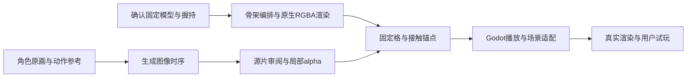

# 图像动作制作方法 v2

客户端日期：2026-10-23。现已验证两条离线制作路线：历史生成图像时序的透明边缘修整，以及已确认固定三维模型直接渲染RGBA。后者已完成江砚秋五套短剑法与正式养成闭环，并获用户本机正向反馈；多角色、新镜头、双手棍法、Windows实机与长期性能仍未因此通过。

历史生成路线另在2026-10-12完成新剑／拳两段后山研究预览并收到「不错」反馈；选定包可在已记录工具链中重建，棍法生成与全新机器自动安装仍未验证。逐路线、逐平台和用户认可范围见各切片记录。

执行入口：[game-image-motion-build](../.agents/skills/game-image-motion-build/SKILL.md)及其[稳定模型路线](../.agents/skills/game-image-motion-build/references/stable-model-motion.md)；开始新段或变体时复用[任务卡](../.agents/skills/game-image-motion-build/references/shot-brief-template.md)。正式结算与返回使用[养成技能](../.agents/skills/game-cultivation-build/SKILL.md)的[动画行动接入](../.agents/skills/game-cultivation-build/references/animated-activity-integration.md)。以下保留旧路线的有效方法与工具限制，再标明本轮扩展的实际范围。

## 分工与适用范围

**路线A：动作参考＋角色原画 → 生成图像时序 → 审阅与局部alpha → 固定格播放。**

**路线B：已确认固定模型／材质／握持 → 编排骨架动作 → 原生透明RGBA渲染 → 固定格播放。**

两条路线随后都做目标场景融合、真实试玩与按需宿主接入。路线B无需为了形式统一再做视频生成或全图抠像；已有用户路线和素材授权优先。

- 3D／真人动作提供可审阅的身体结构、转向、重心与节奏参考。原画确定角色身份、服饰与画风。
- 路线A的生成阶段把参考动作转成角色画面。结果需要与动作参考比较；参考精确不保证输出骨点、手、武器或脚步逐点精确。
- 路线B用同一模型保住身份／手剑，动作、相机和材质仍需实际检查；高面数或静态好看不代表生产拓扑、完整手指绑定或实时三维性能已通过。
- 离线处理解决 alpha、固定格、脚底锚点和来源记录。Godot运行时显示已制成的素材，读场景时辰天气并应用呈现；不实时生成新招式。
- 宿主／DemoState拥有行动、资源、时辰与Tea等玩法状态。动作播放器不结算奖励。正式接入时沿用宿主一次结算与交互占用规则，不根据素材帧数重新决定消耗。

这条路适合固定镜头、少量人物、预制剑法／棍法与叙事演出。姿态、镜头、服饰或器械改变通常需要新的素材或验证；已经画好的2D帧没有任意观察角度或实时物理碰撞。历史生成单式仍是独立研究入口；当前固定模型五套已接入正式宿主，详见[五套制作](image-motion/jiang-five-sword-sets-20261023.md)与[正式闭环](FORMAL_FIVE_SWORD_CYCLE_SLICE.md)。不能把某条路线的状态套给另一条路线。

## 先写任务卡，再处理一段完整招式

一段素材对应一个稳定shot_id及版本。卡里写明目标场景、角色、器械、单双手握持、身体朝向、起势—发力—收势、播放方式、全动作包围盒、脚点、尺寸与证据。制作路线、总套数是否包括基线、待机／动作入出点及稳定clip ID也应明确；已有会话决定不重复询问。没有证据的seed、模型版本、许可或费用写未知。不能把历史样本的61帧／25fps／384×576写成所有招式的标准。

动作差异从动作参考开始：步型、重心、转向、节奏、剑路和武器握持共同区别招式。换颜色、镜像或加快同一段素材不能替代新的动作设计；不对持剑手和武器做未经审阅的镜像。

| 阶段 | 输入与保留物 | 本阶段产物 | 扩到下一阶段前要看什么 |
| --- | --- | --- | --- |
| 角色与动作准备 | 原画、身份要点、带来源的3D／真人动作 | 单招式任务卡、参考视频及哈希 | 先看灰模身体协调、脚步、握持和完整起收势 |
| 输入校准 | 固定相机、角色比例、全动作范围 | 人物与武器都留足空间的输入 | 全部帧中剑尖／棍端不出画；背景与阴影不污染人物边缘 |
| 固定模型渲染（路线B） | 获批源模型／材质／握持、动作曲线与渲染依赖 | 可编辑工程、原生RGBA、分段任务与复用收据 | 同角色、正常／半速身体与剑路、手腕／足底、共同待机与回位；几何数字不能替代观感 |
| 生成（路线A） | 已授权参考和动作输入，保存精确参数 | 原始视频及生成记录 | 正常速与半速看身份、身体、手剑／双手棍关系；错肢或错武器在这里退回 |
| 透明边缘 | 不可变原视频、解码RGB、模型版本 | alpha候选、局部修正配置和逐帧审阅表 | 换浅／深底并放入实际画景，检查白边、灰块、残影与误擦细部 |
| 打包与锚点 | 已选透明帧、原生时间基准 | atlas、帧表、接触锚点、来源哈希 | 固定画幅／比例，源帧顺序与时序明确，落脚自然，跳跃真实升离地面 |
| 场景呈现 | 已选包、场景自身色调与落点 | 接地影、world调色、可选轻纸感及A/B | 先边缘与接地，再色调与墨线，再微弱材质；保护脸、手与剑 |
| 交付与复用 | 冻结版本与可重建收据 | 原生／Web证据、用户反馈及可回退版本 | 分开记自动检查、实看、设备与用户认可；只把通过的版本作为下一段基线 |

输入时应追求简单背景、没有烘焙光晕或环境投影，但不假设生成服务会完全遵守。全动作留边包括头发、衣摆与武器最大伸展，不能只用站姿取景。零付费探索优先一段完整动作；原生帧率由素材决定，不先用插帧或交叉淡化掩盖动作错误。

## 透明边缘是独立的制作阶段

历史生成片段v4的灰块来自源视频的背景光晕被anime模型保留为实心人物。它与衣袍同样有高alpha，整体提高阈值会误擦人物；整幅general模型又会丢掉细剑。因此可复用的是判断和保护方法，而不是当前坐标或蓝色阈值：

1. 对齐源RGB、原alpha、修正alpha和真实画景，确认脏块确实属于背景。
2. 保留适合人物／细武器的基础alpha；另一模型提供局部候选，不直接全图替换。
3. 只在审阅过的时段、区域内更改，保护闭合衣袍、细发、发带、剑身和握持手。具体连通规则、颜色与轮廓按该段素材重做。
4. 保持RGB、帧次序、时序与锚点；alpha修改外区域逐字节一致。需要改RGB或重新生成时单列修订，不混入“只清边缘”的版本。
5. 看所有被处理帧的连续局部表，再看正常速／半速、浅深底、真实场景与Static。单帧好看不能证明时序边缘稳定。

v4只降低alpha；基础alpha已经丢掉的前景无法用这个操作找回。新招式若有剑／手缺失、出画或明显原片模糊，优先修输入／重新制作，不让shader或遮罩承担姿态修复。棍法必须单独保护两手、握点与棍端。

## 锚点稳定不能抹掉真实身体运动

同一段各帧使用同一个画幅与整体缩放；避免每帧紧裁切并按包围盒自动缩放，造成忽大忽小。alpha或颜色A/B切换保留同一时刻、同一帧、锚点和大小。

历史生成单式v4站定转身使用底部支撑区域取脚点，再做中值与高斯平移平滑；最大平移步进约3.06舞台像素是本样本的观测值。其底部连通部件、30%区域、8行支撑、sigma与半径均不是通用人体算法。新剑／拳使用固定首帧源锚点×cell_scale与统一演员尺度，保留源片身体／脚部位移，参数经后山代表帧查看；固定锚点本身不证明所有脚步无滑动。任务卡写明固定或逐帧、坐标基准、尺度转换及真实位移保留策略。

跃起、腾空、跨步或下蹲应根据源动作写明站定／移动／腾空区间，分别确定舞台基点、真实身体位移与落地，不能把每帧最低像素都固定在地面。否则跳跃会被拉回地上、下蹲会被错误抬高。读取诊断字段前核对区域定义：现有`figure_bbox`实际来自局部脚部区域，不能据名称当作全人物包围盒。

单次动作可保留末帧；正式练剑按合同回到共同待机，再通知宿主返回。两种结束策略分别记录。固定模型路线同时比较首尾骨架、手剑／足底、速度与朝向，并查看渲染接点；相同RGBA端点不能单独证明连续运动。只有有完整起收势、首尾位置／速度／朝向／武器关系经实看连续的素材，才可声明为循环。两段动作拼接也应审阅接点，不能默认交叉淡化两个人影。

## 按职责复用与缓存

| 可共享部分 | 每段或每场景仍要决定的内容 |
| --- | --- |
| 角色参考、发型服饰识别点与来源记录 | 背面／侧面是否充分，生成结果是否保持身份；换装另有素材验证 |
| 带来源的3D动作、固定骨架和取景方法 | 新招式真正的动作差异、器械握持与起收势；一个动作不能自动适配任意角色比例 |
| 解码、模型调用、媒体探测、哈希和图集数学 | 该段帧率／尺寸、处理版本、细部保护和可接受边缘 |
| 帧表与固定格播放器、可选包路径、研究入口配置及固定模型受限catalog | 每招站位／尺度、固定或逐帧锚点、片段接点与动作事件；选包可复用不等于握持、任意媒体或跨场景已验证 |
| 世界调色、接地和轻纸感的处理方法 | 场景色调、脚点／阴影、人物尺寸、材质强度与遮挡；后山参数不能直接成为茶亭默认 |
| QA流程与来源收据 | 每一新段、目标场景、真实设备和用户验收证据 |

原动作、原画和源视频不可变；修订创建新版本，只重新做受影响阶段。调纸感不重新生成动作，改局部alpha不重新取脚点，改后山调色不重做原视频。缓存应能区分源文件、模型及其预处理、工具版本与处理规格；alpha修正另绑定自己的区域配置。相同输入重用中间结果，不重发已成功或结果不明的外部任务。现有修整器只检查部分缓存来源合同，通用化时需把这些依赖显式化，不能声称全流程已有完整缓存键。

研究资产放在游戏仓库内时，同时检查普通游戏与独立预览的导出资源边界。[Godot资源选项](https://docs.godotengine.org/en/stable/tutorials/export/exporting_projects.html#resource-options)中的`all_resources`会导出未被主场景引用的资源。新剑／拳在正式两预设排除研究目录、场景和字体，而独立构建仍选自己的包；实际检查导出包的源资源、导入产物及其余资源保留情况，不能只看入口不引用或配置文字。

任务、素材与场景分工有助于批次并行：各招式独立输入、输出和责任人，单一整合者维护角色一致性、包引用与最终验证；不要让两个任务同时改同一个alpha包、字体或场景profile。按当前机器资源与仓库AGENTS安排重任务；制作skill不替代这些限制。

## 工具现状：有用的实现与尚待通用化部分

| 实际入口 | 已有能力 | 当前绑定／下一用例需做的改动 |
| --- | --- | --- |
| [prepare_pilot.py](../tools/sword_image_driven/prepare_pilot.py) | 离线参考图哈希、动作guide抽样／编码、完整解码及收据 | 固定原画SHA、384方格、CMU样本0–144和60／15fps、QA位置；第二动作须参数化 |
| [package_generated_clip.py](../tools/sword_image_driven/package_generated_clip.py) | 解码、已有ONNX分割、alpha、固定atlas、脚点与来源／版本／哈希记录 | 768×1152、61帧、25fps、2.44秒、图集格子和站定脚点算法写死；不是任意视频打包器 |
| [refine_clip_matte.py](../tools/sword_image_driven/refine_clip_matte.py) | 已审阅区域插值、保护前景、保留RGB、新包与原包并存、复用预测 | 固定原包路径／规格、模型MD5、帧段／轮廓、蓝色发带策略；别把当前配置复制到新人物 |
| [clip_actor.gd](../scripts/sword_image_driven/clip_actor.gd) | 可选manifest、帧表／fps／时长采样、暂停／重播／单次末帧；旧锚点平滑或显式固定源锚点 | 新剑／拳用固定首帧锚点保留源片位移；未实现通用腾空／移动策略，不能自动校准所有动作 |
| [back_mountain_pilot.gd](../scripts/sword_image_driven/back_mountain_pilot.gd)与[材质](../assets/shaders/sword_image_scene_blend.gdshader) | 可选包／标题／字体／固定位置尺度、可选清理alpha；色彩／纸感A/B、后山环境、Static／Resume | 仍继承研究standalone；新两招无清理包则隐藏该切换，参数按场景校准，不是正式宿主集成 |
| [build_pilot.py](../tools/sword_image_driven/build_pilot.py) | 白名单独立staging、输入和Web哈希、Godot导入／导出日志 | 依赖与入口固定后山，不是批处理服务或正式发布工具 |
| [prepare_input.py](../tools/hero_martial/prepare_input.py)与[package_clip.py](../tools/hero_martial/package_clip.py) | 单招输入编码与保护；按实际媒体测量、统一480方格、alpha／atlas和来源收据 | 仅本轮三个固定shot_id；已处理剑50／拳53帧，棍法无源片；旧局部清理规则不复用 |
| [build_review.py](../tools/hero_martial/build_review.py) | 新剑／拳各自后山白名单staging、冻结哈希与导出；排除source.mp4 | 仅两个研究入口；不包含棍法或正式玩法，也不是批量生成服务 |

2026-10-11的方法整理轮只保存文档、skill和任务卡，未改这些工具或创建runtime/addon；后续Git归档将现有单式与研究源码一同保存，归档检查独立记录。通用化保留现有小样作为回归：先增加最小配置入口，再迁移第二段，不复制整份controller或为了目录整齐重构整个工程。

## 固定模型与正式接入的当前工具

| 入口 | 实际用途 | 已知边界 |
| --- | --- | --- |
| [build_sword_cycle.py](../tools/hero_lookdev/build_sword_cycle.py) / [warm_sword_phrase.py](../tools/hero_lookdev/warm_sword_phrase.py) | 从固定源模型编排待机与单段动作 | 江砚秋骨架／网格命名、相机和保护项仍是案例绑定；不是任意角色绑定器 |
| [sword_routine_profiles.py](../tools/hero_lookdev/sword_routine_profiles.py) | 五套独立节奏、剑路与回位曲线 | 原创短组合，非动捕／门派标准套路；不由数字差异直接判定自然度 |
| [build_sword_sets_review.py](../tools/hero_lookdev/build_sword_sets_review.py) | 五套catalog、共享待机、图集及独立审阅stage | 规格与五套数量受限；输入仍是已制作的帧，不是批量动作生成服务 |
| [formal_sword_practice.gd](../scripts/hero_lookdev/formal_sword_practice.gd) | 预检选定资源、接收receipt、动作／回位／完成通知 | 唯一结算继续在宿主；不包含审阅控制器、奖励逻辑或网络分包 |
| [build_formal_sword_cycle.py](../tools/hero_lookdev/build_formal_sword_cycle.py) | 正式入口的局部资源闭包与独立stage | 已补动态拼接目录；扫描仍须经实际引擎／导出消费验证，不是完备静态资源解析器 |
| [verify_sword_sets_motion.py](../tools/hero_lookdev/verify_sword_sets_motion.py)及[宿主验证](../tests/formal_sword_cycle_test.gd) | 动作JSON约束、实际宿主状态／重复输入／返回检查 | 合成时钟不测实时帧率；关键帧实看不等于全900帧人工审阅 |

任务按不可变输入版本分段、记完整依赖与已完成帧哈希，再有条件续做；骨架矩阵相同不足以跨材质／光照／相机／布料状态复用渲染。数字匹配采用明确容差并报告实测残差，不能把很小的非零值说成逐字相同。暂存目录先建立，再执行编码或渲染。中文文案随源字符串与目录数据生成独立OFL字库，并用实际字体资源检查字形。Godot JSON整数值可能以float出现，应核验有限且为整数；动态对象字段显式标注必要类型，时钟边界容忍浮点误差，避免测试假设造成错误结论。

## 使用环境与可重建边界

运行已选包需要锁定的 Godot 4.7.2 与仓库内 atlas／字体／场景依赖，不需要 ONNX 模型或在线生成服务。原单式的离线处理环境记录在[来源收据](../assets/art/sword_image_driven_v1/source.json)：Python 3.12.7、NumPy 2.4.6、Pillow 12.3.0、SciPy 1.18.0、ONNX Runtime 1.27.0、FFmpeg／FFprobe 8.0.1；这是实际使用的版本记录，不是安装锁文件。

新招式标题／控件可能超出原字体子集。核验随包字体cmap及导出依赖；原生Mac的系统字体回退不证明Web字形存在。新剑／拳新增独立OFL子集补齐标题，保留旧字体和默认选择；具体字数、源字体和SHA仍是案例数据。

路线A重新制作 alpha 另需上述依赖和匹配 SHA 的 anime／general 模型文件，模型不随游戏包分发。本轮没有提供自动环境安装、完整依赖锁或从零环境重建验证；“可重建”限定于记录的现有工具链，不表示 fresh checkout 能立即运行所有离线处理命令。重新生成角色动作还依赖外部生成记录，其中未知项仍为未知。

CMU／江砚秋三维对照另有已安装 Blender 4.5.9 LTS 工具链；三个 `study.glb.import` 为源导入设置，需随 Git 保留 60fps 与关闭有损优化／压缩。忽略的 `.godot` 缓存和运行图集的普通 `.import` 文件不因此全部入库。

固定模型路线另需案例记录的Blender、已归档源模型／贴图与骨架曲线；原生透明帧不需要上述分割模型。完整运行资源已入库，生成源工程与分段渲染证据在案例封存中；不能据此声明离线制作工具已有全新机器自动安装或任意角色复现能力。

## 怎样扩到多招式

以下为扩大条件。2026-10-12已完成新剑／拳透明草稿、后山研究入口与最小参数化，用户反馈「不错」；棍法两次生成FAILED，三招全集、Windows及完整器械细节验收未完成，详见[本轮证据](HERO_MARTIAL_THREE_SLICE.md)。可用的招式独立交付；失败招式保留输入／结果，不伪造包或自动扩大重试次数。

当前已实现与下一扩展门槛分别记录，不把旧规划当成仍未实施：

| 阶段 | 当前证据 | 下一边界 |
| --- | --- | --- |
| 历史生成单式 | v4已获认可，保留源片裁切／末段模糊／收势限制 | 未由此证明任意视频抠像或完整套路 |
| 固定角色单式与共同待机 | 造型／暖色／力度／剑路逐轮确认，可完整回位 | 固定手型、简化衣发、原模型拓扑与相机仍有边界 |
| 五套短剑法 | 包含基线共五套，不同身体／剑路，任务卡、catalog、共享待机与逐套试玩已完成并获确认 | 仍非长篇门派套路、双手器械、多角色或多镜头量产 |
| 正式养成 | 资源预检、唯一结算、busy与action ID、收势后返回、精力不足和原师傅／Tea规则已检查，收到本机正向反馈 | Windows实机、长期／低端机与听感分别待验；现有通用toolkit仍未实现 |
| 扩到新器械／新角色 | 按下一次实际用户任务选最小新用例 | 重做对应握持、动作／取景／接触与场景实看；双手棍法尚未由本轮验证 |

未来批次目录可采用每个shot自己的任务卡、inputs／generation／matte／atlas／QA引用；这是组织建议，不是已经创建的批处理系统。中间帧、候选和日志留在忽略的制作区，游戏assets只接经过检查的选定包与可移植来源记录。敏感记录与凭据保持现有本地约定。

## Web规模成本要实测

扩量的成本随招式数、帧数、单帧像素和外观／镜头变体增加。原生帧率、目标显示尺寸、图集padding和纹理压缩共同影响质量和加载，不能用“离线生成”推断运行必然轻量。

历史生成样本6张1568×1752 atlas的一套原始RGBA平面为 `6 × 1568 × 1752 × 4 ≈ 62.9 MiB`，同时保留两套A/B约125.8 MiB；这是忽略纹理压缩、mipmap、驱动和额外副本的计算量级，不是已测GPU峰值。原PNG合计20,357,191 bytes、清理版20,443,859 bytes；历史Web小样PCK为37,459,396 bytes、WASM为39,514,754 bytes，均是当前样本构建的文件大小，不是多招式性能结论。

扩量时应分别测首次下载、包大小、加载时间、同时驻留包数／内存和实际帧耗。当前正式五套已只保留选中动作与共享待机的活动引用，把A/B留给QA；选择时新旧资源短暂并存、实际缓存行为与峰值仍需实测。每套独立网络下载尚未实现。不要一次常驻所有剑谱的全部候选，也不要在没有实看验证时降低帧率／尺寸。多招式之间可共享角色约定与场景材质，独立帧画面的制作成本仍会增长。

本轮五套的稳定活动引用为8页动作＋3页待机，按2560²×4计算约275MiB原始RGBA，仅是纹理尺寸量级，不是实际VRAM。正式Web整包约137MiB，包含全部五套；引用数减少不等于下载量减少。这些数据属于当前案例，不作为未来包的性能预算。

## 验收与退回位置

- **动作／身份错误**：回动作输入或生成阶段；保留失败样本。先不抠像、不调纸感。
- **白边／灰块或细剑误擦**：回alpha阶段；固定同帧A/B和保护区域。检查逐帧局部表及真实画景，不做全局阈值暴力清除。
- **忽大忽小／脚滑／跳跃被拉平**：检查画幅、尺度、锚点与真实位移策略；不把姿态变化当作应全部消除的抖动。
- **人物像贴纸／暮色亮块**：先接地、边缘、世界调色，再克制墨线／纸感；材质效果不改姿态和时间。
- **构建通过但人眼别扭**：保留自动结果和反馈，退回对应制作阶段，不用测试数量覆盖视觉问题。

新段自动检查覆盖资源路径与SHA、媒体完整解码、帧表／尺寸／顺序、几何与锚点、alpha修改边界和模式切换时的深状态保持；需要真正查看起／中／末以及全部被修正帧。历史样本306项素材、411项player与294项真实渲染／50张是当时执行证据，不是未来每段固定检查数。按目标平台检查实际窗口尺寸；本仓库常用1152×720与960×600。独立素材审阅检查正常／半速、Static／Resume、浅深底与天气；正式宿主另按自己的Static与行动合同验收。Web、Windows实机、低端与长时分别记录，用户认可当前小样不自动补齐这些证据。

生成沿用明确已授权的具体输入、目的地与费用范围，不重复索要已给许可；扩大素材／目的地／费用时先核对当前授权。现阶段零付费探索，购买另行确认。不因制作skill存在而新建付费推理、外发新素材或发布。原视频／模型和原包不被修正覆盖，来源／许可未知处保持未知。

本轮已证明同一固定角色的五套单手剑与正式养成消费路径。新器械、角色、视角与性能扩量仍按各自实际任务验证。当前产品路线的下一提案是山门闲逛；这次方法整理没有启动该玩法，也没有安装addon或扩大外部生成／发布权限。
