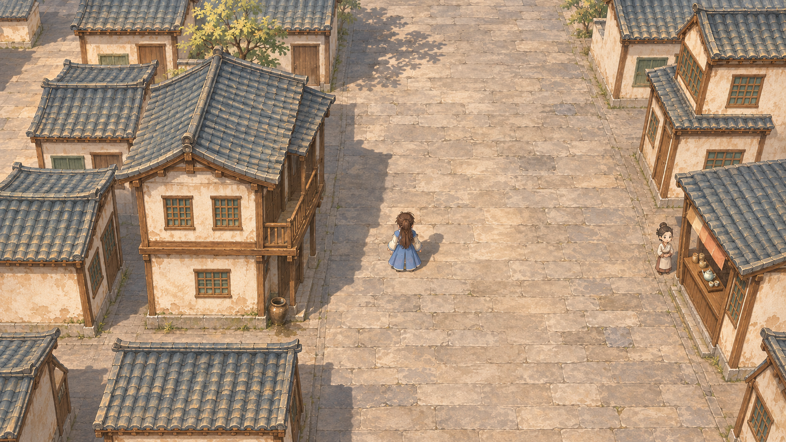
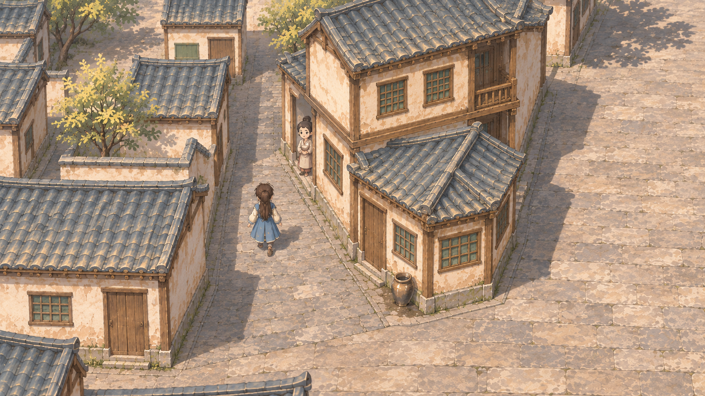
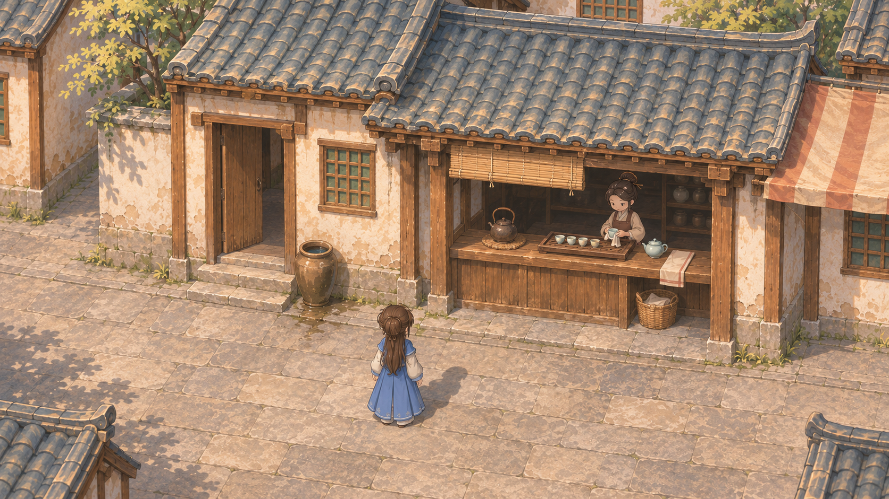

# 成都街景效果参考

2026-11-08。用户要求「先渲染一些图片作为参照」。本组使用内置imagegen制作三张连续街景的效果概念，尚未实装，待用户选择方向。

三图共同关注青灰瓦、米白墙、温木色与灰石铺地的中国画风；增加建筑接地、铺装过渡和有用途的生活细节。空间参考为0.7.4-varied-street实际视口，画风参考为项目原茶街和已认可南门画稿。

## 1. 主街整体

重点看宽路、高低房型、台基与檐下的整体关系，减少地面重复感。

[完整提示词](../../../art/prompts/chengdu-street-references-20261108/01-main-street.txt)

## 2. 巷口衔接

重点看窄巷接主街、转角双面立面、墙根与铺装的过渡。

[完整提示词](../../../art/prompts/chengdu-street-references-20261108/02-side-lane.txt)

## 3. 店前生活细节

重点看茶柜、竹帘、茶具、水缸与门槛的使用关系。

[完整提示词](../../../art/prompts/chengdu-street-references-20261108/03-shopfront.txt)

## 来源与使用范围

[source.json](source.json)与项目[art manifest](../../../art/manifest.jsonl)记录准确提示词、输入顺序、输出SHA和候选状态。实际视口原图按字节保留为[主街参考](reference-current-main.png)与[侧巷参考](reference-current-lane.png)。生成图片原样复制保存，没有二次图像处理；使用内置imagegen，未调用Qwen或付费API，返回模型未回显，记为null。

这三张图用于选择材质、构造和街景整合方向。相机、建筑轮廓和人物是生成式参考，不能直接当成严格工程投影；人物作比例与生活气氛示意，未批准替换角色造型。图中陈设、植物和人物活动尚未接入玩法。后续实施需对照原地块、通路、连续镜头和真实人物重新校准；本轮没有修改游戏场景、玩法、存档或预览包，没有进行游戏构建、Git提交或发布。
